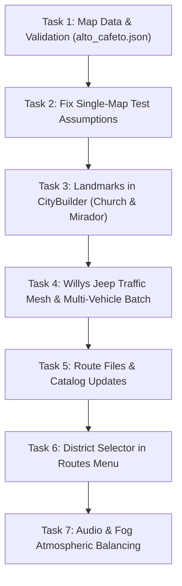

# Map 2 Design Document: Alto Cafeto (Coffee Region)

A second map for **Buseta Simulator: Colombia** (Godot 4.7.2 / GDScript), providing a contrast to the flat Caribbean coast of Puerto Marisol with a steep, colourful Andean coffee town.

---

## 1. Town Name Options

1. **Alto Cafeto**: Evokes high-altitude coffee cultivation on Andean ridge tops while remaining completely fictional and avoiding clashes with real municipalities.
2. **Villa Neblina**: Captures the atmospheric morning fog and cloud-forest ridges characteristic of the Cordillera Central.
3. **Balcones de la Loma**: Highlights the traditional bahareque architecture, vibrant cantilevered wooden balconies, and steep topography.

**Selected Pick**: **Alto Cafeto**. It is short, punchy, distinctly Colombian, fits cleanly on mobile HUD cards, and immediately communicates the setting.

---

## 2. Feel & Gameplay vs. Puerto Marisol

| Dimension | Puerto Marisol (Coast) | Alto Cafeto (Eje Cafetero) | Engine Status & Citations |
| :--- | :--- | :--- | :--- |
| **Topography** | Flat coastal grid, gentle swells (+7m to +9m, <9% grade). | Dramatic mountain ridge (+16m mirador, -3m depot valley), 8% to 13% road grades, winding switchbacks. | **Supported**: `GroundSurface.add_hill()` ([ground_surface.gd](file:///Users/benchiverton-hunt/Claude/Games/Buseta/scripts/world/ground_surface.gd#L23)), `MapLoader.build_ground()` ([map_loader.gd](file:///Users/benchiverton-hunt/Claude/Games/Buseta/scripts/world/map_loader.gd#L55)), and terrain ribbons in `CityBuilder._lifted()` ([city_builder.gd](file:///Users/benchiverton-hunt/Claude/Games/Buseta/scripts/world/city_builder.gd#L377)). Bus physics models slope gravity deceleration `GRAVITY * road_slope` in `BusPhysicsModel._integrate_speed()` ([bus_physics_model.gd](file:///Users/benchiverton-hunt/Claude/Games/Buseta/scripts/vehicle/bus_physics_model.gd#L169)) and measures road slope in `BusController._slope_along_heading()` ([bus_controller.gd](file:///Users/benchiverton-hunt/Claude/Games/Buseta/scripts/vehicle/bus_controller.gd#L130)). |
| **Street Feel** | Wide avenues, 2.5m building setbacks, open beach views. | Enclosed, intimate streets flanked by colourful 2-storey houses with balconies, tight curbs, no beach/sea. | **Supported via Data**: `CityTheme.street_gap = 0.5` ([city_theme.gd](file:///Users/benchiverton-hunt/Claude/Games/Buseta/scripts/world/city_theme.gd#L25)), `palm_share = 0.0`. Omitting `coast` defaults `coast_x` to `INF` (`GroundSurface.NO_COAST`), hiding sea and sand automatically. Road narrowing is physically achieved via `parked_cars` and `knockables` which pinch lanes down to 0.25m from centerline in `LaneGraph._pinch_lanes()`. |
| **Local Traffic** | Yellow sedans/taxis and motorbikes. | Willys-style utility 4x4s ("Yipaos") carrying plantains/coffee sacks, plus motorbikes. | **Needs New Code**: Currently `ObstacleField._mesh_for("car")` ([obstacle_field.gd](file:///Users/benchiverton-hunt/Claude/Games/Buseta/scripts/world/obstacle_field.gd#L297)) builds a generic sedan. `TrafficSystem._build_car_batch()` ([traffic_system.gd](file:///Users/benchiverton-hunt/Claude/Games/Buseta/scripts/traffic/traffic_system.gd#L250)) must support a jeep mesh builder (`_mesh_for("jeep")`). |
| **Morning Fog** | Sunny coastal glare, tropical haze. | Dense valley fog ("neblina") clinging to lower slopes at dawn, breaking into crisp mountain light. | **Supported**: `CityTheme.fog` ([city_theme.gd](file:///Users/benchiverton-hunt/Claude/Games/Buseta/scripts/world/city_theme.gd#L33)), `TimeOfDay.fog_scale` ([time_of_day.gd](file:///Users/benchiverton-hunt/Claude/Games/Buseta/scripts/weather/time_of_day.gd#L30)), and `WeatherDirector.apply()` ([weather_director.gd](file:///Users/benchiverton-hunt/Claude/Games/Buseta/scripts/weather/weather_director.gd#L108)). |
| **Rain & Grip** | Coastal downpours (aguaceros) on flat roads. | Mountain squalls (chubascos) making steep downhill descents slippery and lengthening braking distances. | **Supported**: `WeatherClock`, `RainSettings`, `CityBuilder._on_weather()` ([city_builder.gd](file:///Users/benchiverton-hunt/Claude/Games/Buseta/scripts/world/city_builder.gd#L148)), and grip scaling down to 0.7 in `BusPhysicsModel.grip`. |
| **Landmarks** | Malecón, Port terminal, TransMilenio-style busway. | Plaza Principal with parish church, scenic Mirador overlooking coffee hills, terraced plantations. | **Needs New Code**: `CityBuilder` currently only builds houses, commercial blocks, roundabout obelisks (`_build_island`), and depot (`_depot`, [city_builder.gd](file:///Users/benchiverton-hunt/Claude/Games/Buseta/scripts/world/city_builder.gd#L594)). Church facade and Mirador timber deck require dedicated procedural mesh builders. |

---

## 3. Map Layout & Specifications

Alto Cafeto occupies approximately **340m x 320m** (roughly half Puerto Marisol's 650m x 600m footprint).

```
                             [ e: Mirador (+16m) ]
                                    /     \
   [ f: Barrio Alto (+12m) ]-------+       \ Camino al Mirador
          |                        |        \
          | Carrera Parroquia      |         [ d: Mercado (+7m) ]
          |                        |                 |
   [ g: Guayacanes (+8m) ]         |                 | Carrera Comercio
          \                        |                 |
           \ Carrera Colina  [ c: Plaza Principal ]--+
            \                      | (+6m, Church)
             \                     |
              \----+---------------+
                   | Calle Real
             [ h: Cruce Real (+3m) ]
                   |
                   | Subida del Cafetal (Switchbacks)
             [ b: Curva Café (+1m) ]
                   |
             [ a: Entrada Sur (0m) ]
                   |
          [ depot: Patio Cafeto (-2m) ]
```

### 3.1 Nodes
```json
[
  {"id": "depot", "x": -120, "z": 140, "kind": "terminal", "radius": 17},
  {"id": "a",     "x": -60,  "z": 140, "radius": 14},
  {"id": "b",     "x": 20,   "z": 140, "radius": 14},
  {"id": "h",     "x": -60,  "z": 40,  "radius": 14},
  {"id": "c",     "x": 20,   "z": 40,  "kind": "roundabout", "radius": 20, "island": 8},
  {"id": "d",     "x": 120,  "z": 40,  "radius": 14},
  {"id": "e",     "x": 130,  "z": -110,"radius": 16},
  {"id": "f",     "x": -20,  "z": -110,"radius": 14},
  {"id": "g",     "x": -110, "z": -40, "radius": 14}
]
```

### 3.2 Roads
- `depot_road`: `depot` -> `a`, 30 km/h, traffic: false, `"Carrera del Patio"` (50m)
- `subida_cafetal`: `a` -> `b`, 30 km/h, `"Subida del Cafetal"` (80m)
- `curva_cafe`: `b` -> `h`, 30 km/h, via: `[[30, 90], [-20, 70]]`, `"Curva del Café"` (115m, hairpin climb)
- `calle_real`: `h` -> `c`, 30 km/h, `"Calle Real"` (80m, paved colonial entrance)
- `carrera_comercio`: `c` -> `d`, 30 km/h, `"Carrera del Comercio"` (100m, market stalls)
- `camino_mirador`: `d` -> `e`, 40 km/h, via: `[[155, -20], [150, -75]]`, `"Camino al Mirador"` (175m, scenic climb)
- `calle_las_lomas`: `e` -> `f`, 30 km/h, via: `[[60, -118]]`, `"Calle de las Lomas"` (155m, ridge crest)
- `bajada_guayacanes`: `f` -> `g`, 30 km/h, via: `[[-80, -95], [-115, -70]]`, `"Bajada de los Guayacanes"` (125m, descent)
- `carrera_colina`: `g` -> `h`, 30 km/h, `"Carrera de la Colina"` (95m, lower bypass)
- `carrera_parroquia`: `c` -> `f`, 30 km/h, `"Carrera de la Parroquia"` (150m, direct steep incline)

### 3.3 Hills
Hill bell-curves provide relief without exceeding maximum engine drive traction (~12-14% max gradient):
- **Mirador Summit**: `{ "x": 135, "z": -115, "radius": 140, "height": 16.0 }` (Summit elevation +16m)
- **Barrio Alto Ridge**: `{ "x": -20, "z": -115, "radius": 125, "height": 12.0 }` (Ridge elevation +12m)
- **Plaza Plateau**: `{ "x": 20, "z": 40, "radius": 130, "height": 6.0 }` (Gently elevated town square)
- **South Coffee Basin**: `{ "x": 50, "z": 150, "radius": 120, "height": 4.0 }` (Rolling plantation terraces)
- **Depot Lowland**: `{ "x": -130, "z": 150, "radius": 110, "height": -3.0 }` (Depot valley basin)

### 3.4 Theme & Scenery Parameters
- `walls`: Vibrant colonial palette (white base with mustard, turquoise, terracotta, deep red, sky blue, olive).
- `roofs`: Weathered clay terracotta tiles (`Color(0.68, 0.35, 0.22)`).
- `leaves`: Dark lustrous coffee and broadleaf greens (`Color(0.18, 0.42, 0.16)`).
- `palm_share`: `0.0` (no coconut palms; replaced with mountain oak, guayacán, and wax palms).
- `street_gap`: `0.5`, `gap_low`: `0.5`, `gap_high`: `2.5` (compact street wall).
- `lowest_storeys`: 1, `highest_storeys`: 3, `house_share`: 0.75, `office_share`: 0.0.
- `chimneys`: `false`, `bunting_every`: 65.0.

### 3.5 Features & Props
- **Speed Bumps**: 4 units protecting pedestrian crossings:
  - `calle_real` (along: 40m, approach to Plaza)
  - `carrera_comercio` (along: 50m, market zone)
  - `carrera_parroquia` (along: 30m, steep descent warning)
  - `bajada_guayacanes` (along: 80m, hairpin descent control)
- **Potholes**: 8 potholes situated on older cobblestone sections of `calle_las_lomas` and `subida_cafetal`.
- **Parked Cars / Willys Jeeps**: 6 units strategically placed along `carrera_comercio`, `calle_real`, and `calle_las_lomas` to create single-lane bottlenecks.
- **Knockables**: 12 fruit/coffee crates (`"crate"`), 6 refuse bins (`"bin"`), and 4 artisan market stalls (`"stall"`).
- **Bird Clusters**:
  - `plaza_aromas`: `{"x": 20.0, "z": 32.0, "perch": 5.2, "flock": 4, "range": 28.0}` (Plaza gardens)
  - `mirador_canopy`: `{"x": 132.0, "z": -118.0, "perch": 6.0, "flock": 5, "range": 32.0}` (Forest overlook)
  - `cafetal_entrada`: `{"x": -50.0, "z": 138.0, "perch": 4.5, "flock": 3, "range": 26.0}` (Coffee grove)

---

## 4. Routes & 3-Star Goals

### Route C0: Vuelta al Pueblo (Starter Route)
*A gentle introductory run from the lower depot up through Calle Real to the Plaza and back.*
- **Type**: `service: "bays"`, Length: ~820m, Target Time: 170s (~2.8 min).
- **Stops**:
  1. *El Cafetal* (`subida_cafetal`, along: 45, waiting: 2)
  2. *Plaza Principal* (`calle_real`, along: 65, waiting: 4)
  3. *Patio Cafeto* (`depot_road`, along: 40, dir: -1, waiting: 0, final: true)
- **Goals**:
  1. `finish_under`: 240 (4:00 limit)
  2. `no_collisions`
  3. `no_fines`

### Route C1: Ruta del Mirador (Scenic Summit Run)
*Climb through the market and up the winding ridge road to the town's highest panoramic viewpoint.*
- **Type**: `service: "informal"` (hail spacing: [130, 210], vendor_every: 2), Length: ~1,450m, Target Time: 310s (~5.2 min).
- **Stops**:
  1. *Entrada Real* (`subida_cafetal`, along: 50, waiting: 3)
  2. *Plaza Principal* (`calle_real`, along: 65, waiting: 5)
  3. *Mercado Campesino* (`carrera_comercio`, along: 70, waiting: 4)
  4. *Mirador de las Lomas* (`camino_mirador`, along: 150, waiting: 3)
  5. *Barrio Alto* (`calle_las_lomas`, along: 120, waiting: 2)
  6. *Patio Cafeto* (`depot_road`, along: 40, dir: -1, waiting: 0, final: true)
- **Goals**:
  1. `finish_under`: 420 (7:00 limit)
  2. `no_knocked` (requires clean driving along narrow market stalls)
  3. `vendors`: 2

### Route C2: Circuito Las Lomas (Technical Mountain Loop)
*A demanding loop navigating steep vertical climbs on Carrera Parroquia, hairpins, and narrow ridge crests.*
- **Type**: `service: "informal"` (hail spacing: [110, 180], vendor_every: 3), Length: ~1,850m, Target Time: 390s (~6.5 min).
- **Stops**:
  1. *Curva del Café* (`curva_cafe`, along: 80, waiting: 4)
  2. *Plaza Principal* (`calle_real`, along: 65, waiting: 6)
  3. *La Parroquia* (`carrera_parroquia`, along: 85, waiting: 4)
  4. *Mirador de las Lomas* (`camino_mirador`, along: 150, waiting: 3)
  5. *Descenso Guayacanes* (`bajada_guayacanes`, along: 75, waiting: 3)
  6. *Patio Cafeto* (`depot_road`, along: 40, dir: -1, waiting: 0, final: true)
- **Goals**:
  1. `perfect_stops` (requires precision stopping on sloped approaches)
  2. `satisfaction`: 85
  3. `no_missed`

---

## 5. Progression & Menu Integration

### 5.1 Unlock Requirement
- **Driver Level 6**: Requires **1,500 total XP** ([driver_level.gd](file:///Users/benchiverton-hunt/Claude/Games/Buseta/scripts/progression/driver_level.gd#L9)).
- A typical 3-star shift earns ~85-95 score points + 51 XP (3 stars * 17) = ~135-145 XP.
- Reached in exactly **10 to 12 shifts**, matching the target progression curve.

### 5.2 Menu Presentation
On the **Routes Tab** ([main_menu.gd](file:///Users/benchiverton-hunt/Claude/Games/Buseta/scripts/ui/main_menu.gd#L304)):
- A new segmented district switcher appears above the route cards:
  `[ Puerto Marisol ]   [ Alto Cafeto (Nivel 6) ]`
- If the player is below Level 6:
  - The "Alto Cafeto" button shows a padlock icon with `"Nivel 6"`.
  - Tapping displays a tooltip: `"Alcanza el nivel 6 conduciendo en Puerto Marisol para desbloquear Alto Cafeto"`.
  - `UnlockProgress.next()` naturally surfaces "Alto Cafeto" as the upcoming milestone reward.
- Once unlocked:
  - Tapping switches the active district card filter.
  - Route C0 is free (`cost: 0`), ready to play immediately.
  - Subsequent routes follow the unlock chain: C1 requires C0; C2 costs 1,200 coins.

### 5.3 Catalog & Pack Schema
- In `data/packs/colombia/catalog.json`:
  Add `"district": "alto_cafeto"` or `"map": "maps/alto_cafeto.json"` to route entries, and assign `"level": 6` to the starter route `route_c0`.
- In `data/packs/colombia/pack.json`:
  Add `"maps/alto_cafeto.json"` to the package content manifest.

---

## 6. Implementation Plan & Build Order



### Task 1: Map Data & Data Validation
- **Files**: `data/packs/colombia/maps/alto_cafeto.json`, `scripts/world/map_loader.gd`.
- **Details**: Create the complete map JSON with nodes, roads, hills, features, bird clusters, and theme. Ensure no coast block exists so `GroundSurface.NO_COAST` is active.
- **GUT Tests**: Add `test_alto_cafeto_map_integrity()` in `test/unit/test_city.gd` (verifying node degree, road connectivity, absence of beach drop, and bird cluster validity).

### Task 2: Refactor Single-Map Test Assumptions
- **Files**: `test/unit/test_route_data.gd`.
- **Details**:
  - `test_route_data.gd:10` currently hardcodes `puerto_marisol.json`. Update `_build()` to use `MapLoader.read_map_of(route_data)`.
  - `test_route_data.gd:43` asserts final stop name is `"Patio Central"`. Update to allow `"Patio Central"` or `"Patio Cafeto"` (or check `stop.is_final`).
  - `test_route_data.gd:76` checks `map_data["parked_cars"]` against all routes; update to check each route against its own map.
- **GUT Tests**: Run `tools/test.sh test/unit/test_route_data.gd` to confirm regression-free execution.

### Task 3: Procedural Church & Mirador in CityBuilder
- **Files**: `scripts/world/city_builder.gd`.
- **Details**:
  - Detect node kinds `"church"` and `"mirador"` in `_build_scenery()` ([city_builder.gd](file:///Users/benchiverton-hunt/Claude/Games/Buseta/scripts/world/city_builder.gd#L517)).
  - Build church: tall bell tower, arched belfry, pitched nave, tiled roof, decorative cross-less architraves.
  - Build mirador: octagonal timber observation deck with rustic perimeter fence, wood-plank floor, and viewing benches.
- **GUT Tests**: Add `test_mountain_landmarks_build_without_overlap()` in `test/unit/test_city.gd`.

### Task 4: Willys Jeep Traffic Model
- **Files**: `scripts/world/obstacle_field.gd`, `scripts/traffic/traffic_system.gd`.
- **Details**:
  - Add `_mesh_for("jeep")` in `ObstacleField.gd`: flat hood, round front lights, rear spare tyre, roll bar, and colourful rear canopy.
  - In `TrafficSystem.gd`, read map vehicle theme; allow spawning jeeps in place of sedans for mountain districts.
- **GUT Tests**: Add `test_jeep_batch_creation_and_extents()` in `test/unit/test_traffic.gd`.

### Task 5: Route Files & Progression Hooks
- **Files**: `data/packs/colombia/routes/route_c0.json`, `route_c1.json`, `route_c2.json`, `data/packs/colombia/catalog.json`.
- **Details**: Implement the three route JSON files. Register routes under `catalog.json` with appropriate `requires` and `level: 6`.
- **GUT Tests**: Add `test_coffee_routes_load_and_score()` in `test/unit/test_route_goals.gd`.

### Task 6: District Selector on Menu
- **Files**: `scripts/ui/main_menu.gd`.
- **Details**: Add segmented button row in `_routes_tab()`. Filter shown routes by selected district. Apply level check on district selection.
- **GUT Tests**: Add `test_routes_tab_district_filtering_and_lock_badge()` in `test/unit/test_touch_ui.gd`.

### Task 7: Atmospheric Tuning (Fog & Mountain Ambient)
- **Files**: `data/packs/colombia/pack.json`.
- **Details**: Set mountain fog scale (1.35x for dawn/morning) and ensure bird cluster positional loops trigger near coffee groves.

---

## 7. Key Engineering Risks & Mitigations

1. **Bus Physics Hill Stall Risk**:
   - *Risk*: `GRAVITY` is `9.81` ([bus_physics_model.gd](file:///Users/benchiverton-hunt/Claude/Games/Buseta/scripts/vehicle/bus_physics_model.gd#L16)). At a 19% road slope, gravity resistance is `9.81 * 0.19 = 1.86 m/s²`, which exceeds the starter Caimán B8's `max_drive_accel` (1.85 m/s²), causing the bus to stall and roll backward.
   - *Mitigation*: Cap all road slopes at **12.5% grade** (`max_slope <= 0.125`). Road alignments must traverse hill contours diagonally rather than running straight up fall lines.
2. **Mobile GPU Viewport Overdraw**:
   - *Risk*: Standing at the Mirador (+16m) presents an open vantage point over the entire district, increasing visible triangle counts and fill-rate demands.
   - *Mitigation*: The town size is half Puerto Marisol (~180 buildings vs 340). `LowPolyBuilder` chunks static geometry into 170m batches with frustum culling. Mountain fog distance limits distant overdraw on budget mobile devices.
3. **Hardcoded Map Assumptions in Existing Tests**:
   - *Risk*: Multiple existing unit tests (`test_route_data.gd`, `test_country_packs.gd`) instantiate `puerto_marisol.json` directly and expect specific stop names (`"Patio Central"`).
   - *Mitigation*: Task 2 explicitly abstracts route validation to inspect `MapLoader.read_map_of(route)` rather than a hardcoded path.

---

## 8. Concept Art Prompts

1. **Plaza Principal**:
   > *Low-poly stylized 3D game scene of a vibrant Colombian coffee town plaza. Sunlight breaking through morning mountain mist. A white colonial church with a bell tower and clay tile roof overlooks the square. In the center, a stone fountain surrounded by wax palms. Colourful 2-storey wooden buildings with bright cyan and yellow balconies, flower boxes, and outdoor cafe tables. A cheerful yellow and cream buseta parked at the kerb; a classic Willys jeep loaded with plantains nearby. Bright, saturated, clean cartoon aesthetic, flat shaded, mobile game style.*

2. **Steep Street Descent**:
   > *Low-poly stylized game view down a steep cobblestone street in the Colombian Andes. Narrow street flanked by two-storey colonial houses painted in contrasting pastel coral, lime green, and cobalt blue with ornate wooden balconies. A green-and-white Colombian buseta carefully descends the incline, brake lights glowing. A vintage turquoise Willys jeep parked partially on the narrow sidewalk. In the background, rolling green hills dotted with coffee plants recede into misty valleys. Warm sunlight, crisp edges, clean polygons.*

3. **Mirador Overlook**:
   > *Low-poly scenic 3D viewpoint atop an Andean mountain ridge. A rustic timber observation deck with wooden railings and park benches overlooking expansive terraced green coffee plantations below. Winding mountain roads with switchbacks visible in the valley below. Bright morning sun casting soft shadows, mountain birds flying overhead, fluffy stylized white clouds against a vivid blue sky. Whimsical, inviting, low-poly mobile game environment.*

4. **District Map Bird's-Eye Overview**:
   > *Low-poly isometric overview of a compact mountain town in Colombia's coffee region. Nestled on a green mountain ridge surrounded by coffee shrubs and shade trees. Distinct central plaza with a church tower, winding paved streets connecting a lower bus depot to an upper scenic wooden mirador. Miniature colourful houses with clay roofs, tiny parked jeeps, and asphalt roads with yellow warning lines. Clean miniature diorama, bright natural lighting, stylized cartoon game aesthetic.*
